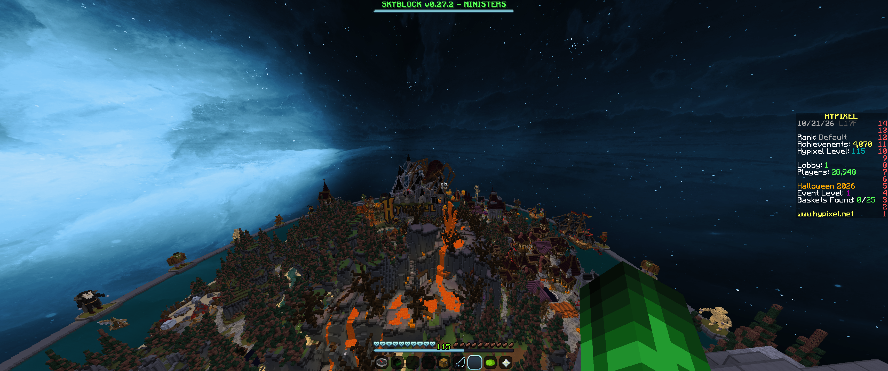
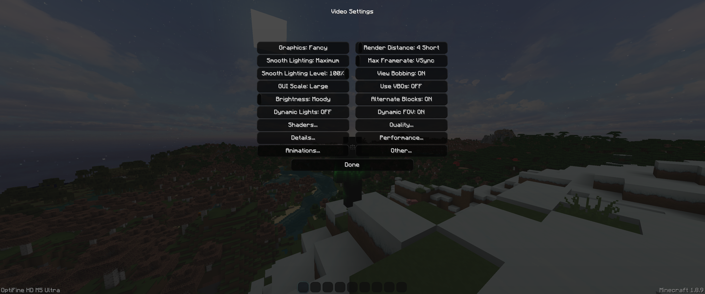
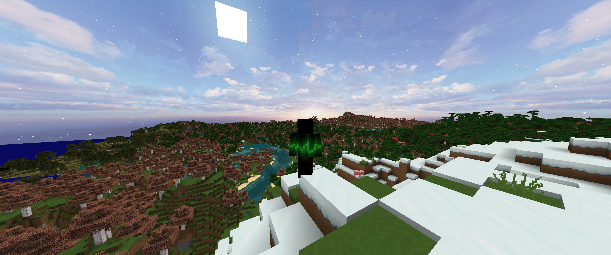
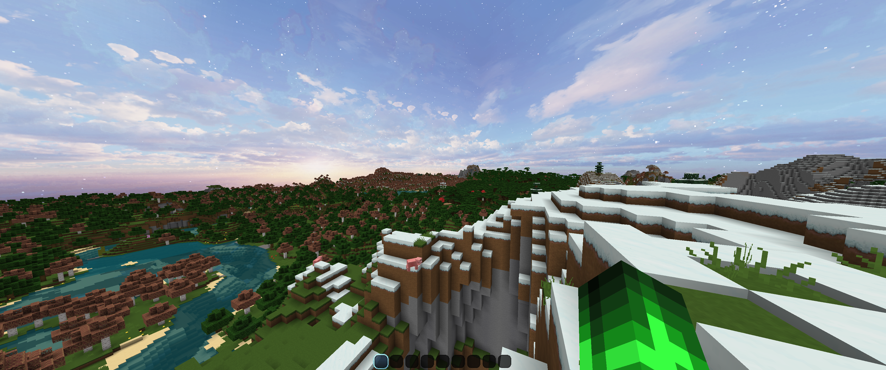

# Rose Glasses

A Minecraft farsight mod for 1.8.9. Allows the client to store chunk data in memory in order to render non-simulated chunks while they are beyond render distance. Compatible with Optifine, works in multiplayer.

[Jump to Setup](#setup)

## How it works

Visual data for chunks are stored client side and then that visual data is passed back into the minecraft renderer. No changes are made to the minecraft rendering engine. Essentially, this mod just tells the renderer to render chunks that it's seen before without checking to see if they've changed first.

Cached chunks will be loaded up to `/roseglass distance` starting from the client render distance (the render distance slider in video-settings)

## Commands (how to set render distance super far)

| Command | What it does | Default |
|---|---|---|
| `/roseglass distance <chunks>` | Sets cached visual radius independently of vanilla distance | **32** |
| `/roseglass debug [on\|off]` | Shows/hides debug overlay; omit argument to toggle | **Off** |
| `/roseglass disk [on\|off]` | Enables/disables disk saving and loading; omit argument to toggle | **On** |
| `/roseglass status` | Displays statistics and active disk-cache location | — |
| `/roseglass` | Same as `status` | — |
| `/roseglass clear` | Clears cached memory and pauses disk reads; leaves disk files intact. (Run if too many chunks are loaded and game becomes too laggy. Also, set /roseglass distance to a lower number) | — |

## Limitations

This is not like distant horizons or voxy: this is not a level of detail mod. Loading an absurd number of chunks will likely cause some lag, although less than expected as the game will not check for updates in those chunks which does cut down overhead. Visual data for chunks are stored on the user's disk and then loaded into memory.

In general, this mod plays nice with other rendering mods as it does not affect whatever process they use to render the chunks near the player. As such, it is compatible with Optifine, although changing default settings may cause some weird rendering behavior near the player. Most other performance mods (Phosphor, PolyPatcher, NoFog, etc.) work fine and greatly improve performance. Mods that interfere with default memory behavior could cause issues. In testing, I had issues with FoamFix. Rendering near the player may be slower due to a slow handoff between the saved chunks and the rendering engine for simulated chunks. Lower the mod settings if this happens (turn distance down).

Minecraft 1.8.9 does not have a separate slider for simulation distance as this was only introduced in later versions of the game. The render distance is the simulation distance. (simulation distance being defined as the distance in-which the game will check for chunk updates). While using this mod, changing your render distance will reload the simulated chunks near you but the mod will still render cached chunks up to your set visual limit (this is 32 by default but can be arbitrarily large).

Chunks cached by the mod are in general going to load in more quickly than chunks loaded with simulation. This means that chunks outside the render distance set by the client will in general load in more quickly than those inside that range. As such, I would generally recommend keeping client render distance somewhat low (like around 12) while using this mod to avoid long wait times and rendering issues. This is less of an issue on multiplayer. 
Loading new chunks is substantially more work, just in general, than loading already cached chunks. So returning to an area will load chunks much faster than loading them all for the first time. 

I would not use this with shaders. Do what you want though.

## Multiplayer Compatibility

This mod will work on multiplayer servers. It is recommended that you have your default client render distance (the render distance slider in video-settings) set to at least 12 on multiplayer servers (such as on hypixel).

This is because of how most multiplayer servers do rendering: they will attempt to send a set number of chunks to the client, and then the client chooses which of those chunks to render on screen based on your slider. If your slider is too low, the server will still send updates for the server-set number of chunks around the player and as such Rose Glasses will not render those chunks which can lead to some weird looking rendering.

So if there are gaps around the player on multiplayer, increase your client render distance (the render distance slider in video-settings) until they go away.

## Setup

Recommended: download .jar file from modrinth, curse forge, or from github (`roseglass-0.7.3.jar`)

Alternatively, you can download the source from github (this project is open source) and compile the mod yourself. DM me if you want a guide on how to do this.

I would only install this mod if you have a dedicated gpu to do rendering with. All testing was done with an RTX 3070. Do what ya want though. [<https://www.reddit.com/r/Minecraft/comments/rp8vfn/how_do_i_set_minecraft_to_use_my_dedicated_gpu/>]
